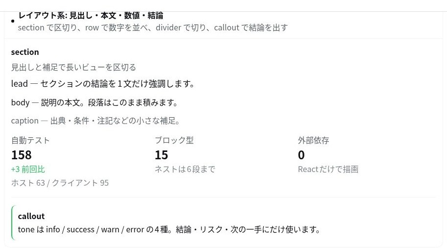
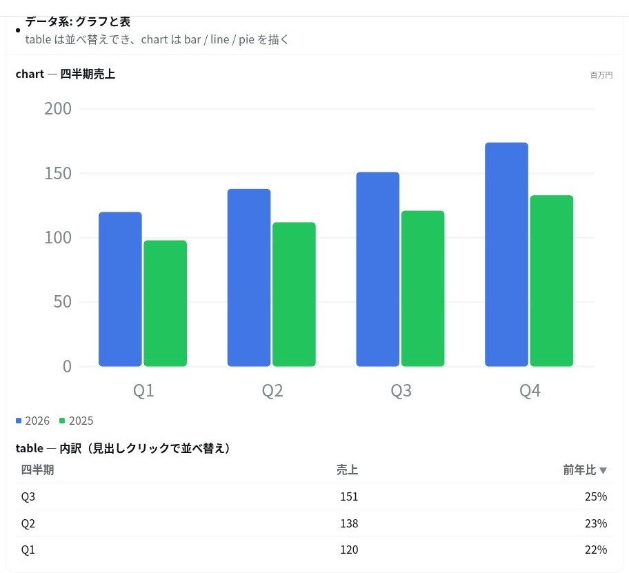
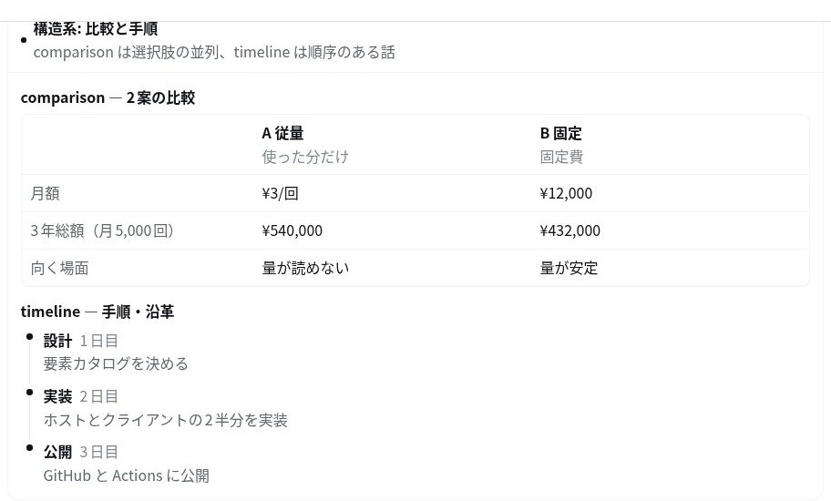
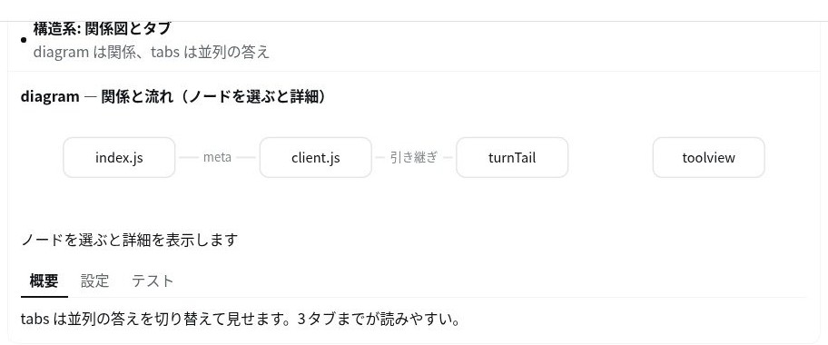
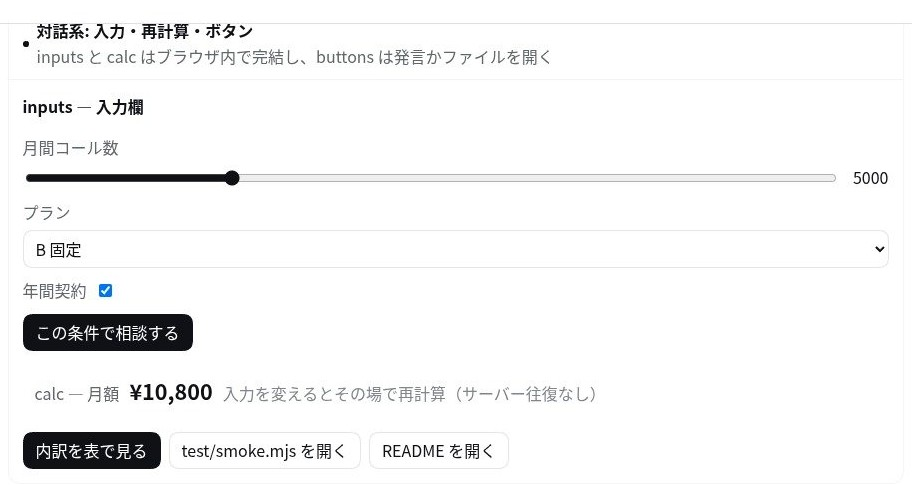

# dsh-intelligent-ui

ChatGPT の Intelligent UI に相当する機能を DeepSeek Harness (DSH) に追加するバンドルです。
モデルは文章だけでなく **`render_ui` ツール**を呼んで、その場に対話的なビュー（表・グラフ・比較・手順・入力欄つきの小さな道具）を返せるようになります。

## 何が起きるか

1. モデルが `render_ui` を呼ぶ。引数は宣言的なブロックの並び（JSON）で、HTML も JavaScript も書かない。
2. ホスト側が引数を検証・正規化し、正規化済みの仕様を結果の `meta` として公開する。
3. クライアント側が 2 か所に描画する。実行中はツール呼び出しの行そのもの（スロット `tool.call.toolview`）をビューに差し替え、応答が完了したらそのビューを回答の直下（スロット `conversation.chat.turnTail`）に置き直す。同じ仕様はセッションログに残るので、リロード後もそのまま再描画される。

### 表示される場所

| タイミング | ツール呼び出しの行 | 回答の下（ターン末尾） |
| --- | --- | --- |
| 実行中（引数のストリーミング中も） | ビュー（引数が届くたびに描き直す） | — （ターンが閉じるまで出ない） |
| 応答完了後 | 「ビューは回答の下に表示しています」の 1 行 | ビュー（常時表示） |

ツール行は「処理の折りたたみグループ」の中にあるため、**応答が完了するとグループごと畳まれて見えなくなります**（作業詳細の表示モードによっては完全に非表示）。そこで、確定したビューはターン末尾にもう一度描画し、返答案の一部として残します。所有権はターン単位で受け渡すので、**同じビューが 2 つ同時に見えることはありません**——折りたたみグループを手動で開いても、そこには 1 行の案内だけが出ます。

対応する要素は 15 種類（`section` / `row` / `text` / `callout` / `divider` / `stat` / `table` / `chart` / `comparison` / `timeline` / `diagram` / `tabs` / `inputs` / `calc` / `buttons`）、ネストは 6 段まで。
`inputs` と `calc` はブラウザ側で完結して再計算し、`buttons[].message` と `inputs.submit.message` は `{{name}}` を現在値に置換してユーザーの発言として送信します。

## カードの種類（全 15 種）

以下はすべて、実際の DSH Web GUI で `render_ui` を呼んで描画した結果をそのまま切り出したものです（ライトテーマ）。5 枚で 15 種類すべてを網羅しています。

### レイアウト — `section` / `row` / `text` / `callout` / `divider` / `stat`

`section` で区切り、`row` で数字を並べ、`divider` で切り、`callout` で結論を出します。`text` は `lead` / `body` / `caption` の 3 段階。



### データ — `chart` / `table`

`chart` は `bar` / `line` / `pie` を描き、`table` は見出しクリックで並べ替え（`sortable`）、`format` で `number` / `percent` を整形します。



### 比較と手順 — `comparison` / `timeline`

`comparison` は選択肢を横に並べ、`timeline` は順序のある話を `at` 付きで見せます。



### 関係と並列 — `diagram` / `tabs`

`diagram` は `flow` / `tree` / `cycle` のレイアウトで、ノードを選ぶと `detail` が出ます。`tabs` は並列の答えを切り替えます。



### 対話 — `inputs` / `calc` / `buttons`

`inputs` の値を変えると `calc` がその場で再計算します（この例は「年間契約」を入れた状態の ¥10,800）。`buttons` は発言を送るか、ファイルを開きます。



## インストール

### 1. Plugin Manager から（推奨）

インストール欄に次の spec を貼り付けます（Settings → Plugins）。

```
github:cwd514/dsh-intelligent-ui
```

エージェントに任せるなら、`plugin_manager` ツールの `install_bundle` に同じ文字列を `target` として渡します。

```
install_bundle target="github:cwd514/dsh-intelligent-ui"
```

### 2. clone してパスを指定する

```
git clone https://github.com/cwd514/dsh-intelligent-ui.git
plugin_manager install_bundle target="/absolute/path/dsh-intelligent-ui"
```

どちらの方法でもプロファイルの `dsh.profile.bundles` に登録され、`render_ui` ツールとビューが有効になります。

## 設定

`cordis.patch.yml` の `config`（すべて省略可）。

| キー | 既定 | 意味 |
| --- | --- | --- |
| `enabled` | `true` | ツールとビューを登録する |
| `posture` | `auto` | システムプロンプトへの追記。`auto`（追記なし・モデル判断）/ `encourage`（積極利用を促す）/ `off`（ツールとビューのみ） |
| `maxBlocks` | `40` | 1 ビューの最大ブロック数 |
| `maxNodes` | `240` | 1 ビューの最大要素数（ネストを含む総量） |
| `promptOrder` | `3200` | `encourage` 時のプロンプトセクションの順序 |
| `extraGuidance` | `''` | 追記する自由記述（`encourage`/`off` のときのみ有効） |

上限はすべて `render_ui: ...` で始まる具体的なエラーになるので、モデルはその場で引数を直せます。

## モデルから見た形

- **ツール**: `render_ui`。説明文は短く保ち、要素の詳細は **ランタイムスキル `intelligent-ui`** に置いています（カタログは常時プロンプトに載らず、必要になったときだけ読み込まれます）。スキルレジストリが無い環境では説明文側にカタログを畳み込みます。
- **スキル本体**: [`catalog.md`](catalog.md) — 全要素の型・フィールド・入力欄の種類・`calc` の文法・実例。
- **posture: auto** ではシステムプロンプトに何も足しません。使うかどうかはモデルが会話から判断します。

## 設計上の約束

- **モデルは HTML も JS も書かない。** 受け取るのは宣言的な仕様だけで、描画はプラグイン内の React コンポーネントが行います。`dangerouslySetInnerHTML` は使いません。
- **`calc` は eval を使わない。** 手書きのトークナイザ + 再帰下降パーサで、許可した関数（`min max sum avg round floor ceil abs sqrt pow if`）以外は呼べません。プロパティ参照も代入も構文エラーになります。
- **色はテーマトークンだけ。** 系列色は `--dsw-alias-state-*` を使い、ライト/ダーク両方で色として読めるようにしています。
- **壊れた部分はそこで止まる。** ブロックごとのエラーバウンダリで、1 つのブロックが失敗しても残りは表示されます。読めない仕様は生の JSON を `<pre>` で見せます。
- **ストリーミング途中でも描く。** 引数が途中でも、閉じていない文字列と括弧を補って読める範囲を先に描画します（読めなければスケルトン）。

## 構成

```
index.js        ホスト側: ツール登録・検証・スキル登録・プロンプト追記
client.js       クライアント側: 2 つのスロット実装（描画・状態・スタイル・ターン末尾への引き継ぎ）
catalog.md      モデルに読ませる要素カタログ（ランタイムスキルの本体）
cordis.patch.yml バンドルの挿入と config
locale/*.json   Plugin 一覧に出す名前と説明（ja/en）
test/smoke.mjs  ホスト 63 件 + クライアント 100 件の自動テスト
```

## テスト

```
npm run check   # node --check
npm test        # 163 件のスモークテスト（ホスト 63 / クライアント 100）
```

クライアント側は `vm.runInThisContext` で `window.__ModuleLoader__` に登録し、最小の React スタブでツリーを組み立てて検証します。デバッグ用に `window.__dshIntelligentUi`（`looseJson` / `sanitizeSpec` / `compileExpr` / `niceTicks` / `diagramEdge` / `lastRender` …）を公開しています。

## 動作確認済みの範囲

DSH Web GUI（`http://127.0.0.1:3080`）で実際に確認しました。

- ツール実行 → ウィジェット描画（`meta` 経由、`phase: result`）
- 実行中はツール行にビューが出て、応答完了後はツール行が 1 行の案内に変わり、同じビューが回答の下に残る（`lastRender.shown` が `card` → `note`、`lastTail.views` が 1）
- ページリロード後もセッションログから再描画（ターン末尾のビューも復元される）
- `inputs` / `calc` の再計算（プラン変更 → ¥0、席数 40 → ¥48,000）
- ボタンのコピー操作、`inputActions` が実アプリから渡っていること（`interactive: true`）
- ライト/ダーク両テーマでの配色
- 15 種類すべてのブロックの実描画（README のギャラリー `docs/blocks-*.jpg` はその実キャプチャ）
- 日本語表示（英語・中国語の辞書は自動テストで検証）

## 既知の制約

- PTC（`mode: ptc`）でツールが入れ子実行されると `meta` が公開されず、引数の生テキストから復元します。呼び出しは `run_code` のカードの中に描かれ、ターン末尾のビューにも同じ呼び出しが並びます（入れ子はノードではなく親ブロックの `subCalls` に入るため、プラグイン側で親を辿って集めています）。
- トークン単位のストリーミング描画ではなく、引数のチャンク単位です。
- 設定用の GUI はありません（`cordis.patch.yml` で設定します）。

## ライセンス

MIT

## English

`dsh-intelligent-ui` brings a ChatGPT-style *Intelligent UI* to DeepSeek Harness (DSH): the model can answer with an interactive view — tables, charts, comparisons, timelines, small calculators — instead of prose alone, by calling the declarative `render_ui` tool. The model never writes HTML or JavaScript; every block is rendered by this plugin's React components from a validated JSON spec. 15 block types, nesting up to 6 levels, `inputs`/`calc` recompute in the browser, and `buttons[].message` is sent back as the user's own utterance.

### Install

Paste this spec into **Settings → Plugins**, or pass it as `target` to the `plugin_manager` `install_bundle` tool:

```
github:cwd514/dsh-intelligent-ui
```

Cloning the repository and installing its absolute path works as well.

### Where the view appears

| When | Tool call row | Below the answer (turn tail) |
| --- | --- | --- |
| Running (and while arguments stream) | the view | — (published only when the Turn ends) |
| Turn complete | one line pointing below | the view |

The Tool call row lives inside the collapsible Tool group, which folds away once the Turn completes. When the Turn closes, ownership of the settled view moves to the Turn tail (`conversation.chat.turnTail`) — outside that group, right under the closing prose — so the view stays part of the answer and is never shown twice.

### Card gallery

Every one of the 15 block types, captured from the real GUI: [layout (section / row / text / callout / divider / stat)](docs/blocks-layout.jpg) · [chart / table](docs/blocks-data.jpg) · [comparison / timeline](docs/blocks-compare.jpg) · [diagram / tabs](docs/blocks-diagram.jpg) · [inputs / calc / buttons](docs/blocks-interactive.jpg).

### Configuration

Optional keys under `config` in `cordis.patch.yml`: `enabled` (true), `posture` (`auto` / `encourage` / `off`), `maxBlocks` (40), `maxNodes` (240), `promptOrder` (3200), `extraGuidance` ('').

### Development

```
npm run check   # node --check
npm test        # 163 smoke checks (63 host / 100 client)
```

The client half is loaded into a Node `vm` context against a minimal React stub: slot registration, spec sanitising, the `calc` parser, the streaming argument reader, the settled-view hand-off and the Turn tail are all covered. The same checks run in GitHub Actions.

### Limitations

- Under PTC (`mode: ptc`) nested calls publish no `meta`, so the view is rebuilt from the raw argument text; it also appears in the Turn tail.
- Streaming redraws per argument chunk, not per token.
- No settings GUI — configure through `cordis.patch.yml`.

### License

MIT
